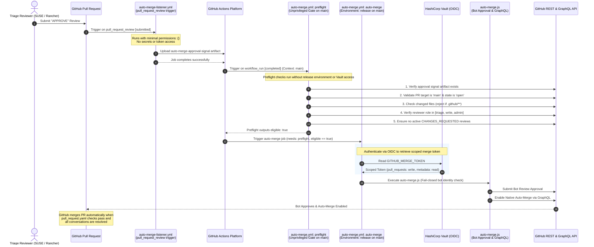

# Component Specification: Automated PR Merge System on Main

- **Related Topic:** [GitHub Workflows & Automation](../GitHubWorkflows.md)
- **Related Topic:** [Pull Request & Merge Lifecycle on Main](./PullRequestLifecycle.md)
- **Overview:** [End-to-End Value Stream Lifecycle](./Overview.md)
- **Downstream:** [Backport Orchestration & Issue Tracking](./BackportOrchestration.md)

---

## Abstract

This component specification details the automated pull request merge system for pull requests targeting the default `main` branch. It bridges the gap between GitHub's native role hierarchy—which requires `write` permissions to approve pull requests and enable auto-merge—and the repository's least-privilege security model, where trusted team members are assigned the `triage` role to prevent unauthorized release creation.

Using a two-stage Listener-Executor architecture and HashiCorp Vault OpenID Connect (OIDC) token retrieval, the system validates human review approvals from triage members, ensures no critical workflow paths are modified, posts an automated bot approval, and enables GitHub's native auto-merge engine.

---

## Problem & Architectural Intent

### The Role Hierarchy Challenge
In GitHub, write access grants repository members the ability to merge release PRs and push tags that trigger production releases (`release-please.yml` on `release/v*`). To enforce separation of duties, only a restricted group of release maintainers possess `write` access, while day-to-day engineers and trusted contributors operate with `triage` access.

However, GitHub's native repository rulesets and branch protections only count approvals from users with `write` access toward required review thresholds, and only permit users with `write` access to toggle auto-merge.

### The Solution
When an authorized engineer with `triage` access reviews and approves a PR targeting `main`, the automated merge system safely acts on their behalf:
1. It validates the reviewer's repository permissions via the GitHub API.
2. It verifies all repository security constraints (such as the exclusion of workflow modifications).
3. It uses a scoped Vault token to post an automated Bot review approval.
4. It calls the GitHub GraphQL API to enable native `auto-merge` on the PR.
5. GitHub's native rulesets handle final gating: requiring all status checks in `pull_request.yaml` to pass and requiring all review conversations (including Copilot suggestions) to be marked resolved prior to merging.

---

## Security Model: Listener-Executor Architecture

To protect repository secrets and Vault OIDC credentials from untrusted PR code, the system implements the strict Listener-Executor pattern with an unprivileged preflight validation gate:



---

## Strict Security & Validation Gates

Before submitting an automated approval or enabling auto-merge, `.github/workflows/scripts/auto-merge.js` enforces the following gates:

1. **Target Branch & State Gate**:
   - The PR target branch must strictly equal `main`.
   - The PR must be `open` and must not be in `draft` mode.

2. **Review State & Non-Self Approval**:
   - The review that triggered the event must have state `APPROVED`.
   - The reviewer must not be the author of the pull request (`review.user.login !== pr.user.login`).

3. **Role & Permission Verification**:
   - The reviewer's repository permission is checked via `GET /repos/{owner}/{repo}/collaborators/{username}/permission`.
   - The effective permission must be `triage`, `write`, or `admin`. Users with `read` or `none` permissions are rejected.

4. **Workflow File Modification Exemption**:
   - Changed files are retrieved via `GET /repos/{owner}/{repo}/pulls/{number}/files`.
   - If any file path begins with `.github/`, the bot explicitly rejects auto-merging and logs that workflow modifications require human write/admin approval.

5. **No Active Changes Requested**:
   - The script inspects all reviews on the PR.
   - If any reviewer has an active review with state `CHANGES_REQUESTED`, the bot refuses to approve or enable auto-merge until that reviewer re-reviews or their review is cleared.

6. **Idempotency & Stale Approval Protection**:
   - The bot checks existing reviews to ensure it has not already approved the current `head.sha`.
   - If new commits are pushed, GitHub's native branch protection dismisses stale approvals and requires a new human triage review.

---

## Native Auto-Merge Integration

Once the security gates pass, the bot:
1. Submits an approval review via `POST /repos/{owner}/{repo}/pulls/{number}/reviews` with message:
   ```markdown
   Automated approval triggered by @<reviewer> (role: <role>).
   ```
2. Executes the GraphQL mutation `enablePullRequestAutoMerge`:
   ```graphql
   mutation EnableAutoMerge($pullRequestId: ID!, $mergeMethod: PullRequestMergeMethod!) {
     enablePullRequestAutoMerge(input: {
       pullRequestId: $pullRequestId,
       mergeMethod: $mergeMethod
     }) {
       pullRequest {
         autoMergeRequest {
           enabledAt
           enabledBy {
             login
           }
         }
       }
     }
   }
   ```
   The `mergeMethod` defaults to `SQUASH`.

GitHub's native branch ruleset then guarantees that:
- All required status checks in `pull_request.yaml` must pass.
- All review conversation threads (human and Copilot) must be resolved.
- The PR will be atomically merged once all conditions are satisfied.
