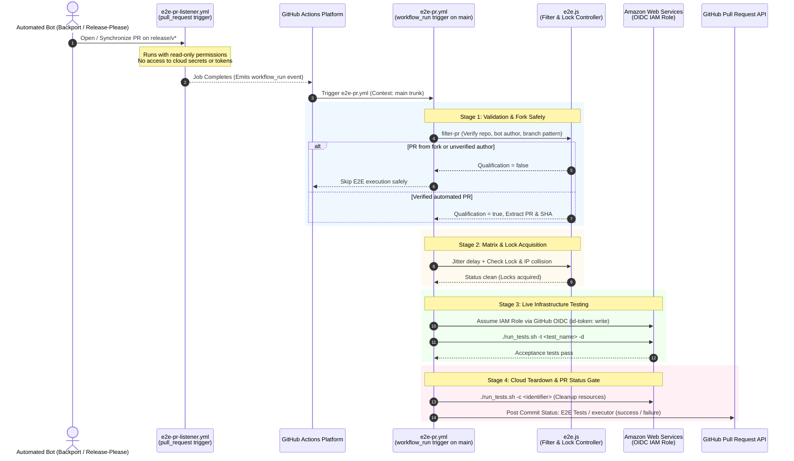

# Component Specification: Privileged AWS End-to-End Testing

- **Related Topic:** [GitHub Workflows & Automation](../GitHubWorkflows.md)
- **Related Topic:** [Release Process & Automation](../ReleaseProcess.md)
- **Overview:** [End-to-End Value Stream Lifecycle](./Overview.md)
- **Upstream:** [Backport Orchestration & Issue Tracking](./BackportOrchestration.md)
- **Downstream:** [Branch-Based Releases](../ReleaseProcess/BranchReleases.md)

---

## Abstract

This component specification details the automated End-to-End (E2E) integration testing infrastructure of `terraform-provider-rancher2`. It documents how live acceptance tests are executed against Amazon Web Services (AWS) using OpenID Connect (OIDC) authentication, distributed concurrency controls, and a two-stage Listener-Executor security pattern.

Acceptance tests execute against qualifying automated Pull Requests (automated cherry-pick backports and Google `release-please` PRs) targeting release branches (`release/v<major>`) *prior* to merging, providing pre-merge validation gates directly within the GitHub PR user interface.

---

## Security Model: The Listener-Executor Architecture

Running tests that assume cloud IAM roles presents severe security risks if triggered directly by pull requests, where arbitrary fork code could exfiltrate cloud credentials. To achieve zero-trust isolation, the repository splits E2E testing into two workflows:



---

## Workflow Components & Execution Lifecycle

### 1. The PR Listener (`.github/workflows/e2e-pr-listener.yml`)

- **Trigger**: Runs on `pull_request` targeting `release/v*` branches (`types: [opened, synchronize, reopened]`).
- **Permissions**: Read-only (`contents: read`).
- **Function**: Executes a simple shell echo statement. Its sole purpose is to produce a successful `workflow_run` event on GitHub Actions, signaling that PR activity occurred on a release branch.

### 2. Privileged E2E Executor (`.github/workflows/e2e-pr.yml`)

- **Trigger**: Runs on `workflow_run` when workflow `PR Executor Listener` completes.
- **Trusted Context**: Executes using the workflow definition from the repository default branch (`main`), preventing external PRs from tampering with test runner logic.
- **Timeout**: 360 minutes (6 hours) to accommodate full cloud provisioning lifecycles.
- **Permissions**: Top-level `permissions: {}` enforces least privilege. Per-job permissions are explicitly declared:
  - `filter`: `contents: read`, `pull-requests: read`
  - `setup`: `permissions: {}`
  - `test`: `actions: read`, `contents: read`, `id-token: write`
  - `audit`: `actions: read`, `contents: read`
  - `cleanup`: `contents: read`, `id-token: write`
  - `e2e-status`: `contents: read`, `statuses: write`

---

## Detailed Executor Job Pipeline

### Job 1: Filter (`filter`)

The filter job invokes `runFilterPr` in `.github/workflows/scripts/e2e.js` (`SCRIPT_MODE: filter-pr`) to resolve the target PR and verify all eligibility criteria:

1. **Non-Fork Verification**: Compares `pr.head.repo.full_name` with `pr.base.repo.full_name`. Forks are immediately rejected.
2. **Target Branch Pattern**: Verifies the PR base branch matches `/^release\/v\d+$/`.
3. **Authorized Bot Identity**: Ensures the PR author belongs to approved automation: `github-actions[bot]` or `rancher-merge-bot[bot]`.
4. **Head Branch Pattern**:
   - Automated Backport: `^backport-\d+-(?:release-)?v\d+$`
   - Release-Please PR: `^release-please--branches--release(?:--|\/)v\d+$`
5. **Outputs**: If eligible, exports `should_run = 'true'`, `pr_number`, `branch`, and `sha`.

### Job 2: Setup (`setup`)

Constructs the dynamic test matrix:
```json
["TestOneBasic", "TestThreeBasic", "TestProductionBasic"]
```

### Job 3: Matrix Test Execution (`test`)

Executes in parallel for each test in the matrix across 3 staggered attempts:

1. **Concurrency Jitter**: Calculates a progressive delay based on the matrix index (`strategy.job-index * 45s`) to prevent runner race conditions.
2. **Lock & IP Collision Prevention**:
   - Downloads all active workflow artifacts.
   - **IP Collision (`check-ip`)**: Resolves runner public IP (`curl -s https://ipinfo.io/ip`). Verifies whether another concurrent job already registered that IP in an artifact named `ip-<ip>-<index>`. If an older index job is running on the same IP, flags collision to avoid AWS API throttling.
   - **Test Locking (`check-lock`)**: Checks whether another runner is currently executing the same test (`lock-<test_name>-<index>`).
3. **Disk Space Optimization (`clear-runner`)**:
   - Calls `runClearRunner` to delete unused SDKs (Android, .NET, Swift, Julia, Powershell) and prunes Docker volumes to reclaim >30GB of runner disk space.
4. **Hermetic Compilation**:
   - Runs `make test` inside `ghcr.io/rancher/ci-image/nix:20260603-18` via `nix-run.sh`.
5. **AWS OIDC Authentication**:
   - Uses `aws-actions/configure-aws-credentials` to assume role `arn:aws:iam::270074865685:role/terraform-module-ci-test` in `us-west-2` via GitHub OIDC token exchange.
6. **Live Test Execution**:
   - Invokes `./run_tests.sh -t "$TEST_NAME" -d` with a unique UUID identifier.
   - Provisions live AWS infrastructure (VPCs, EC2 nodes, Rancher clusters), validates resource lifecycle behavior, and destroys test assets.

### Job 4: Audit (`audit`)

Runs `runCheckRun` in `e2e.js` (`SCRIPT_MODE: check-run`) after all test matrix jobs complete. Validates that every scheduled test produced a corresponding lock artifact in the workflow run, ensuring tests were not silently bypassed or cancelled.

### Job 5: Cloud Resource Cleanup (`cleanup`)

Guaranteed to execute (`if: always()`). Re-authenticates to AWS via OIDC and invokes:
```bash
./run_tests.sh -c "$IDENTIFIER"
```
Scans for any orphaned test infrastructure tagged with the unique identifier and issues forceful cloud terminations.

### Job 6: Commit Status Check Gate (`e2e-status` job)

Runs `runE2EStatus` in `e2e.js` (`SCRIPT_MODE: e2e-status`). Evaluates the collective results of `filter`, `test`, `audit`, and `cleanup`:
- Submits a commit status check with context `'E2E Tests / executor'` to the target PR's head commit SHA (`POST /repos/{owner}/{repo}/statuses/{sha}`):
  - **Context**: `E2E Tests / executor`.
  - **State**: `success` or `failure`.
  - **Target URL**: Link to the GitHub Actions workflow run.
  - **Description**: `E2E tests passed successfully` or `E2E tests failed`.

---

## Standing Implementation Decisions

1. **Pre-Merge Execution**: E2E tests run on PRs *prior* to merging into release branches. This guarantees that broken builds never contaminate release branches or block subsequent backports.
2. **Strict Fork Isolation**: External forks are barred from triggering cloud tests. Only repository-internal automated bot branches can invoke OIDC credential exchanges.
3. **Distributed Artifact Locks**: Workflows coordinate test execution state dynamically using GitHub Actions workflow artifacts rather than external state databases.
4. **Guaranteed Cloud Cleanup**: The `cleanup` job runs under `if: always()` to ensure temporary cloud infrastructure is eradicated even if test execution crashes or times out.
5. **Commit Status Gate Integration**: The `E2E Tests / executor` commit status context check provides a native GitHub branch protection requirement, preventing auto-merge from advancing if tests fail.
