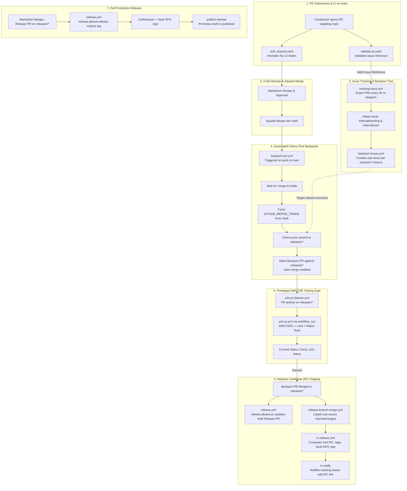

# Component Specification: End-to-End Value Stream & Workflow Lifecycle

- **Related Topic:** [GitHub Workflows & Automation](../GitHubWorkflows.md)
- **Related Topic:** [Release Process & Automation](../ReleaseProcess.md)
- **Deep Dive (PR & CI Matrix):** [Pull Request & Merge Lifecycle on Main](./PullRequestLifecycle.md)
- **Deep Dive (Backports):** [Backport Orchestration & Issue Tracking](./BackportOrchestration.md)
- **Deep Dive (E2E Tests):** [Privileged AWS End-to-End Testing](./EndToEndTesting.md)
- **Deep Dive (Release Candidates):** [Branch-Based Releases](../ReleaseProcess/BranchReleases.md)
- **Deep Dive (Production Releases):** [Release Please Automation](../ReleaseProcess/ReleasePlease.md)

---

## Abstract

This specification documents the complete, end-to-end value stream of the `terraform-provider-rancher2` repository—tracing code modifications from an initial pull request targeting `main` through automated issue tracking, branch-based backporting, functional AWS E2E testing, release candidate staging, and final GPG-signed production releases.

The pipeline coordinates 13 GitHub Actions workflows, custom JavaScript/Bash automation controllers, and HashiCorp Vault secrets inside hermetic Nix containers (`ghcr.io/rancher/ci-image/nix:20260603-18`) to enforce rigorous quality, deterministic SemVer releases, and defense-in-depth isolation against untrusted fork contributions.

---

## High-Level Value Stream Architecture

The lifecycle follows a deterministic, 7-stage value stream centered around `main` as the development trunk and `release/v<major>` branches as stabilization and delivery vehicles:

---

## Detailed Value Stream Stages

### Stage 1: Pull Request Submission & CI Matrix on `main`

- **PR Description Validation (`.github/workflows/validate-pr.yaml`)**:
  - Triggers on `pull_request` targeting `main` (`opened`, `edited`, `reopened`, `synchronize`, `ready_for_review`).
  - Executes `.github/workflows/scripts/validate-pr-description.js` using `actions/github-script`.
  - Enforces that the PR description includes a tracking line matching `- Addresses: #<issue number>` or `* Addresses: #<issue number>`.
  - Verifies via the GitHub API that the referenced issue exists, is currently open, and is not a pull request.
  - Skips bot PRs, draft PRs, and `release-please` branches.
- **Hermetic CI Matrix (`.github/workflows/pull_request.yaml`)**:
  - Executes inside container image `ghcr.io/rancher/ci-image/nix:20260603-18` via `.github/workflows/scripts/nix-run.sh`.
  - Runs 11 parallel quality and safety jobs:
    1. **Build (`make build`)**: Cross-platform compilation (`CROSS=1`).
    2. **Test (`make test`)**: Provider Go unit tests.
    3. **Terraform**: Validates formatting and runs `tflint --recursive`.
    4. **Actionlint**: Validates all GitHub Actions workflow YAML files.
    5. **Node Check**: Verifies syntax of all JavaScript automation scripts (`node --check`).
    6. **Node Tests**: Runs unit tests on automation tooling via `node --test` (`*.test.js`).
    7. **ESLint**: Runs ESLint across all repository modules.
    8. **ShellCheck**: Statically analyzes all shell scripts with `shellcheck -x`.
    9. **Validate Commit Message**: Validates Conventional Commit prefixes (`fix:`, `feat:`, `chore:`, etc.), 100-character line length, and spelling via `cspell`.
    10. **Gitleaks**: Audits commits for hardcoded tokens, passwords, and private keys.
    11. **Sensitive Checks**: Tests and executes `check_sensitive.go` against provider schemas to ensure sensitive attributes are marked appropriately.

### Stage 2: Tracking Issue Adoption & Backport Tree Generation

- **Tracking Issue Adoption (`.github/workflows/tracking-issue.yml`)**:
  - Runs periodically via cron (`0 */4 * * *`) or via manual `workflow_dispatch`.
  - Fetches `GITHUB_MERGE_TOKEN` from HashiCorp Vault (`rancher-eio/read-vault-secrets`).
  - Executes `releases.js` (`SCRIPT_MODE: tracking-issue`).
  - Scans open, non-draft PRs targeting `main` and extracts the referenced issue.
  - Dynamically detects the latest active release branch (e.g., `release/v15`) by querying repository branches matching `/^release\/v\d+$/`.
  - Labels the referenced issue with `internal/tracking`, `internal/user`, and the target release branch label.
  - Injects tracking comments (`<!-- tracking-pr: #<pr_number> -->`) and contributor instructions.
  - Dispatches `backport-issues.yml` for the target release branch.
- **Backport Sub-Issue Creation (`.github/workflows/backport-issues.yml`)**:
  - Triggers when a `release/v*` label is added to an issue or via manual dispatch.
  - Executes `backports.js` (`SCRIPT_MODE: backport-issues`).
  - Extracts the linked PR from the parent issue's tracking comments.
  - Ensures idempotency by verifying whether a sub-issue for that release branch already exists.
  - Creates a dedicated backport issue titled `[<release_branch>] <parent_issue_title>`, assigned to `TERRAFORM_MAINTAINERS` with labels `internal/backport` and `<release_branch>`.
  - Links the issue as a sub-issue of the parent tracking issue using GitHub's Sub-Issues API (`POST /repos/{owner}/{repo}/issues/{issue_number}/sub_issues`).

### Stage 3: Human Review & Squash-Merge to `main`

- **Review Gating**:
  - Repository maintainers (`TERRAFORM_MAINTAINERS`) review code changes, review automated CI check results, and collaborate with the author to resolve feedback.
- **Squash-Merge**:
  - Once approved and all CI checks pass, maintainers squash-merge the PR into `main`, producing a single clean commit SHA with Conventional Commit syntax on trunk.

### Stage 4: Automated Cherry-Pick & Backport PR Generation

- **Push Trigger & API Settle (`.github/workflows/backport-prs.yml`)**:
  - Triggers on push to `main` (manual fallback in `backport-pr-manual.yml`).
  - Step `wait-for-settle`: Polling loop in `backports.js` with exponential backoff ensures GitHub's API has indexed the merge commit and its associated pull request.
  - Step `get-merge-token`: Fetches privileged `GITHUB_MERGE_TOKEN` from HashiCorp Vault.
- **Cherry-Pick PR Generation**:
  - Executes `backports.js` (`SCRIPT_MODE: backport-pr`).
  - Locates the tracking issue linked to the merge commit and fetches its active sub-issues via the `/sub_issues` API.
  - For each sub-issue with a valid `release/v*` label:
    - Checks out target branch `origin/<target_branch>`.
    - Creates a backport branch named `backport-<pr_number>-<target_branch>`.
    - Cherry-picks the merge commit (`git cherry-pick --allow-empty -x <sha> -X theirs`).
    - Pushes the backport branch to origin.
    - Opens a Backport PR targeting the release branch referencing the sub-issue.
    - Enables native GitHub auto-merge on the backport PR (`enablePullRequestAutoMerge` with `mergeMethod: SQUASH`).
    - Assigns `TERRAFORM_MAINTAINERS` and applies `internal/pr-backport` and target branch labels.

### Stage 5: Privileged AWS E2E Testing Gate (Pre-Merge)

- **PR Listener (`.github/workflows/e2e-pr-listener.yml`)**:
  - Triggers on `pull_request` events targeting `release/v*` (`opened`, `synchronize`, `reopened`).
  - Emits a completion event without performing privileged actions or accessing cloud secrets.
- **Privileged E2E Test Suite (`.github/workflows/e2e-pr.yml`)**:
  - Triggers via `workflow_run` upon listener completion, running exclusively from the trusted `main` branch context.
  - **Filter Job (`filter-pr`)**: Runs `e2e.js` to ensure the PR is not from an external fork, targets `release/v*`, and is authored by an authorized automation bot (`github-actions[bot]`, `rancher-merge-bot[bot]`) with branch prefix `backport-` or `release-please--`.
  - **Setup Matrix**: Prepares test matrix for `TestOneBasic`, `TestThreeBasic`, and `TestProductionBasic`.
  - **Matrix Execution (`test`)**: Runs across 3 attempts with distributed locking and IP collision prevention to avoid concurrent AWS resource conflicts.
    - Enforces jitter delay (`JOB_INDEX * 45s`).
    - Queries workflow artifacts for IP or test locks before proceeding.
    - Runs unit tests (`make test`).
    - Assumes AWS IAM role `arn:aws:iam::270074865685:role/terraform-module-ci-test` via GitHub OIDC.
    - Executes live functional tests (`./run_tests.sh -t <test_name> -d`).
  - **Audit Job (`audit`)**: Verifies that all expected tests ran and produced lock artifacts.
  - **Cleanup Job (`cleanup`)**: Always runs to assume the AWS role and execute `./run_tests.sh -c <identifier>`, ensuring zero orphaned cloud resources.
  - **Status Gate (`e2e-status`)**: Evaluates results and writes a commit status check (`e2e-status`) to the PR head commit via the GitHub Statuses API.

### Stage 6: Release Candidate (RC) Staging on Release Branches

- **Backport PR Merge**:
  - Once CI and E2E tests pass, the backport PR merges into `release/v*` (via auto-merge or maintainer).
- **Release Please Staging (`.github/workflows/release.yml`)**:
  - Triggers on push to `release/v*`.
  - `release-please-release` job executes. Since this is a backport commit (not a merged release PR), no release is created.
  - `release-please-pr` job executes using Vault credentials: calls Google's `release-please-action` with `skip-github-release: true` to create or update an ongoing draft Release PR containing cumulative changelogs and upcoming SemVer increments.
- **RC Release Dispatch (`.github/workflows/release-branch-merge.yml`)**:
  - Triggers via `workflow_run` upon completion of `release.yml` on `release/v*`.
  - `label` job: Executes `backports.js` (`SCRIPT_MODE: merge-label`) to attach the `internal/merged` label to the related backport issue.
  - `trigger-rc-release` job: Executes `releases.js` (`SCRIPT_MODE: trigger-rc-release`).
    - Detects whether the merged PR was a `release-please` PR; if so, skips RC creation.
    - Computes the next RC tag (e.g., `v15.2.0-rc.1` -> `v15.2.0-rc.2`) via `computeNextRcTag` by evaluating existing tags, `release-please-config.json`, and `.release-please-manifest.json`.
    - Dispatches `rc-release.yml` on `main` with the target branch, commit SHA, and computed RC tag.
- **RC Tag Creation & Packaging (`.github/workflows/rc-release.yml`)**:
  - Runs in `ghcr.io/rancher/ci-image/nix:20260603-18` with environment `release`.
  - Validates that the tag starts with `v` and contains `rc`.
  - Pushes the Git tag, prepares `terraform-registry-manifest.json`, and retrieves GPG signing credentials from Vault.
  - Compiles and cryptographically signs provider binaries using GoReleaser with `.goreleaser_rc.yml` via `.github/workflows/scripts/goreleaser.sh`.
  - `find-issues-create-comments` job: Executes `releases.js` (`SCRIPT_MODE: rc-notify`), discovering all open issues with labels `<branch>`, `internal/backport`, and `internal/merged`, and commenting with the release candidate link for QA validation.

### Stage 7: Full Production Release

- **Release PR Approval & Merge**:
  - Maintainers validate the RC build with QA.
  - Once validated, maintainers review and squash-merge the pending `release-please` PR on `release/v*`.
  - (Note: E2E tests validate the `release-please` PR prior to merge via the Stage 5 listener/executor pipeline).
- **Automated Tagging & Binary Publication (`.github/workflows/release.yml`)**:
  - Triggers on push to `release/v*`.
  - `release-please-release` job detects the merged Release PR, outputs `release_created: true`, and extracts the new release tag name (e.g., `v15.2.0`).
  - `release` job runs:
    - Checks out codebase and workflow scripts from `main`.
    - Clears runner disk space (`e2e.js` `clear-runner`).
    - Retrieves GPG signing credentials (`passphrase`, `privateKeyId`, `privateKey`) from Vault.
    - Runs GoReleaser with `.goreleaser.yml` inside Nix, compiling and signing cross-platform binaries.
    - Executes `releases.js` (`SCRIPT_MODE: publish-release`), promoting the draft GitHub release to published (`draft: false`).
  - `release-please-pr` job updates the release manifest and opens the next release PR cycle.
- **Manual Release Fallback (`.github/workflows/manual-release.yml`)**:
  - Allows authorized maintainers (`TERRAFORM_MAINTAINERS`) to manually trigger a full release on a selected branch and commit SHA.
  - Verifies user authorization via `releases.js` (`check-maintainer`).
  - Verifies the tag does not contain `rc`.
  - Creates the tag, retrieves Vault GPG credentials, compiles and signs binaries via GoReleaser, and publishes the release.
- **License Scanning (`.github/workflows/fossa.yml`)**:
  - Pushes to `main` and `release/**` trigger FOSSA scans using tokens retrieved from HashiCorp Vault.

---

## Standing Implementation Decisions

1. **Trunk-Based Development on `main`**: All feature work and bug fixes enter exclusively via pull requests targeting `main`. Code is never authored directly against release branches.
2. **Release Branches as Delivery Channels**: Releases (both RCs and stable versions) are generated exclusively from `release/v<major>` branches (e.g. `release/v15`, `release/v14`, `release/v13`).
3. **Automated Backport Isolation**: Target release branches are protected from direct commits. Backports are cherry-picked into dedicated branches (`backport-<pr>-<branch>`) and submitted as PRs.
4. **Privileged Fork Isolation via `workflow_run`**: PRs from forks never receive write tokens or cloud credentials. Privileged E2E tests execute strictly via `workflow_run` using trusted workflow definitions on `main`.
5. **Pre-Merge E2E Testing**: Acceptance tests run against automated backport PRs and release PRs *before* merging into release branches, writing status checks to PR heads.
6. **Cryptographic Signing via Vault**: All release candidate and production binaries are signed with GPG keys fetched dynamically from HashiCorp Vault during CI execution.
7. **Manifest-Driven SemVer**: Release versioning, changelogs, and tag creation are managed deterministically by Google's `release-please` running in manifest mode (`release-please-config.json` and `.release-please-manifest.json`).
8. **Hermetic Nix Execution**: All builds, linters, tests, and release steps execute inside pinned Nix container images (`ghcr.io/rancher/ci-image/nix:20260603-18`) to ensure 100% reproducible environments.
