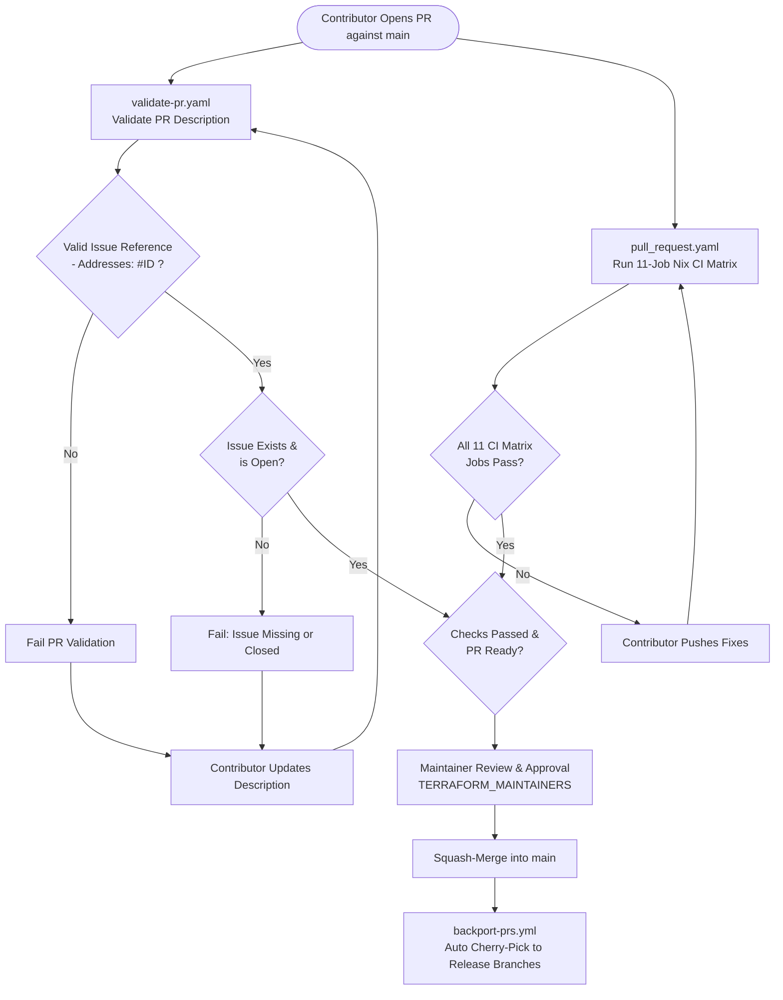

# Component Specification: Pull Request & Merge Lifecycle on Main

- **Related Topic:** [GitHub Workflows & Automation](../GitHubWorkflows.md)
- **Related Topic:** [Release Process & Automation](../ReleaseProcess.md)
- **Overview:** [End-to-End Value Stream Lifecycle](./Overview.md)
- **Downstream:** [Backport Orchestration & Issue Tracking](./BackportOrchestration.md)

---

## Abstract

This specification details the lifecycle of pull requests submitted against the default `main` branch. It documents the end-to-end flow from initial contribution and issue link validation through continuous integration quality checks, maintainer code reviews, and squash-merging into trunk.

---

## High-Level Overview

All codebase enhancements, bug fixes, and dependency updates enter the repository through pull requests targeting `main`. Contributors submit pull requests from forks or feature branches, which pass through automated validation and continuous integration pipelines before maintainers merge them:

1. **Issue Association Validation**: Every PR targeting `main` must declare an issue reference in its description matching `- Addresses: #<issue number>` (or `* Addresses: #<issue number>`). The referenced issue must be an existing, currently open GitHub issue (and not a PR).
2. **Hermetic Continuous Integration Matrix**: Pinned Nix containers compile cross-platform provider binaries, execute Go unit tests, lint Terraform examples, verify GitHub Actions workflows and scripts, validate Conventional Commit messages, scan for secrets with Gitleaks, and check schema sensitivity.
3. **Collaborator Review & Approval**: Repository maintainers (`TERRAFORM_MAINTAINERS`) review the code and test coverage. Once approved and all CI checks pass, maintainers squash-merge the PR into `main`.
4. **Post-Merge Trigger**: Merging into `main` produces a single commit SHA on trunk, immediately triggering automated cherry-pick backport workflows (`backport-prs.yml`).

---

## Workflow Components & Triggers

The PR lifecycle on `main` is governed by two core workflows:

### 1. PR Description Validation (`.github/workflows/validate-pr.yaml`)

- **Trigger**: Runs on `pull_request` targeting `main` when `types` are `[opened, edited, reopened, synchronize, ready_for_review]`.
- **Exclusions**: Evaluates `if: github.event.pull_request.user.type != 'Bot' && !startsWith(github.head_ref, 'release-please') && !github.event.pull_request.draft` to skip draft PRs, bots, and release-please branches.
- **Context & Permissions**: Operates on `ubuntu-latest` with minimal permissions (`contents: read`, `pull-requests: read`, `issues: read`).
- **Execution Script**: Calls `.github/workflows/scripts/validate-pr-description.js` using `actions/github-script`.
- **Validation Rules**:
  - Cleans HTML comments and code blocks from the PR body.
  - Matches lines formatted strictly as:
    ```markdown
    - Addresses: #1234
    * Addresses: #1234
    - Addresses: `#1234`
    ```
  - Resolves each matched issue against the GitHub REST API (`GET /repos/{owner}/{repo}/issues/{issue_number}`).
  - Fails if the issue does not exist (404), if the target is actually a pull request (`issue.pull_request != null`), or if the issue is already closed (`issue.state !== 'open'`).

### 2. Pull Request Continuous Integration Matrix (`.github/workflows/pull_request.yaml`)

- **Trigger**: Runs on every `pull_request` event.
- **Concurrency**: Cancels obsolete in-flight runs on the same branch (`concurrency.cancel-in-progress: true`).
- **Container Environment**: All jobs execute inside hermetic Nix containers:
  ```yaml
  container:
    image: ghcr.io/rancher/ci-image/nix:20260603-18
  ```
  Jobs invoke tools through the runner wrapper `.github/workflows/scripts/nix-run.sh`, which drops privileges to the unprivileged `suse` user while preserving essential environment variables.
- **Parallel Quality Jobs**:
  1. **Build (`build`)**: Executes `make build` with `CROSS=1` to compile cross-platform provider binaries for Linux, Darwin, and Windows across AMD64 and ARM64.
  2. **Test (`test`)**: Executes unit tests via `make test` using `gotestsum` with standard verbose formatting and test report generation.
  3. **Terraform Linting (`terraform`)**: Executes `lint.sh terraform`, verifying `terraform fmt -check -recursive -diff` and running `tflint --recursive`.
  4. **Actionlint (`actionlint`)**: Executes `lint.sh actionlint` to validate all workflow YAML definitions against GitHub Actions schema rules.
  5. **Node Syntax Check (`node-check`)**: Executes `lint.sh node-check` using `node --check` across all JavaScript automation files in the repository.
  6. **Node Unit Tests (`node-test`)**: Executes `lint.sh node-test` using Node's native test runner (`node --test`) against all `*.test.js` files under `.github/workflows/scripts/`.
  7. **ESLint (`eslint`)**: Executes `lint.sh eslint` using `npm ci` and `eslint .` to enforce modern ECMAScript style.
  8. **ShellCheck (`shellcheck`)**: Executes `lint.sh shellcheck` scanning all shell scripts with `shellcheck -x`.
  9. **Commit Message Validation (`validate-commit-message`)**: Executes `validate-commit-message.sh`:
     - Fetches commit messages for the PR via GitHub API (`repos/{owner}/{repo}/pulls/$PR_NUMBER/commits`).
     - Enforces Conventional Commit prefixes: `fix:`, `feature:`, `feat:`, `refactor!:`, `feature!:`, `feat!:`, or `chore(main):`.
     - Enforces line length $\le$ 100 characters.
     - Performs automated spell checks using `cspell` with repository dictionary `custom_words.txt`.
  10. **Secret Scanning (`gitleaks`)**: Executes `lint.sh gitleaks` across working files and Git history (`continue-on-error: true`).
  11. **Schema Sensitivity Audit (`sensitive-checks`)**: Tests and runs `.github/workflows/scripts/check_sensitive.go` to flag sensitive attributes and schema definitions that require security review.

---

## Activity Flow



---

## Standing Implementation Decisions

1. **Mandatory Issue Association**: Code changes cannot enter `main` without an existing, open tracking issue. This ensures end-to-end traceability across issue trackers and release notes.
2. **Trunk-Based Linear History**: Direct rebase or merge commits into `main` are disallowed. All PRs are squash-merged by maintainers, resulting in one atomic commit SHA per PR on `main`.
3. **Hermetic Nix Containers**: CI runs exclusively inside pinned container images (`ghcr.io/rancher/ci-image/nix:20260603-18`) to eliminate environmental differences between developer machines and CI runners.
4. **Automated Concurrency Management**: In-flight workflow runs on the same branch or PR ref are cancelled automatically when new commits are pushed, preventing stale resource consumption.
5. **Human-Gated Merge Authority**: While backport PRs use automated squash auto-merging, contributions targeting `main` require explicit review, approval, and manual squash-merging by a repository maintainer.
